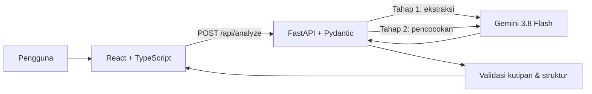

# Software Design Document — SkillBridge AI

Versi: 0.1 · Sasaran: capstone, dengan jalur pengembangan hackathon.

## 1. Masalah dan pengguna

Mahasiswa sering melihat daftar syarat magang tanpa mengetahui pengalaman mana yang dapat menjadi bukti dan kemampuan mana yang perlu diprioritaskan. Pengguna utama adalah mahasiswa yang sedang menyiapkan lamaran magang. Aplikasi membantu mereka merapikan bukti keterampilan dan membuat langkah belajar yang konkret; aplikasi tidak membuat keputusan rekrutmen.

## 2. Ruang lingkup MVP

Pengguna memasukkan dua teks anonim: ringkasan pengalaman dan deskripsi lowongan. Sistem menampilkan maksimal delapan syarat keterampilan, kutipan lowongan, status bukti dari profil, alasan singkat, serta rencana belajar tujuh hari. Tiga contoh anonim tersedia. Tidak ada autentikasi, unggahan berkas, scraping lowongan, database, atau penilaian otomatis terhadap kandidat.

## 3. Arsitektur



Pada pengembangan, Vite menjalankan frontend dan mem-proxy `/api` ke FastAPI. Pada demo satu server, FastAPI menyajikan `frontend/dist` setelah `npm run build`. Backend membaca `GEMINI_API_KEY` dari environment variable. React menggunakan `fetch` dan tidak mengetahui kunci model. Setiap panggilan Interactions API memakai `store=False` agar status interaksi tidak disimpan secara default oleh API tersebut.

## 4. Kontrak HTTP

`POST /api/analyze`

```json
{
  "profile_text": "Saya membuat dashboard menggunakan SQL ...",
  "job_text": "Lowongan membutuhkan SQL untuk analisis ..."
}
```

Setelah trim, `profile_text` minimal 20 karakter dan `job_text` minimal 50 karakter; masing-masing maksimal 10.000 karakter. Respons sukses `200`:

```json
{
  "requirements": [
    {
      "requirement_id": "r1",
      "skill": "SQL",
      "job_quote": "SQL untuk analisis",
      "status": "supported",
      "profile_quote": "SQL untuk menganalisis penjualan",
      "reason": "Ada bukti penggunaan SQL."
    }
  ],
  "coverage": { "supported": 1, "total": 1 },
  "learning_plan": [
    { "day": 1, "focus": "SQL", "action": "...", "deliverable": "..." }
  ],
  "notice": "..."
}
```

`learning_plan` selalu berisi hari 1–7. Keluaran memiliki `status` bernilai `supported` atau `not_evidenced`. Untuk `not_evidenced`, `profile_quote` adalah `null` pada respons akhir. `coverage` menghitung syarat yang memiliki kutipan profil; ini bukan skor kelayakan.

Kesalahan validasi masukan dan lowongan tanpa syarat jelas menghasilkan `422`. Kunci tidak tersedia menghasilkan `503` dengan kode `MISSING_API_KEY`. Gangguan model atau keluaran model yang tetap tidak valid setelah satu percobaan ulang menghasilkan `502`, dengan kode `MODEL_UNAVAILABLE` atau `INVALID_MODEL_OUTPUT`.

## 5. Alur AI dan pemeriksaan

1. Prompt ekstraksi mengambil maksimal delapan keterampilan yang tertulis pada lowongan serta kutipan persis. Kode memeriksa kutipan dan menolak daftar syarat duplikat.
2. Backend memberi ID `r1`, `r2`, dan seterusnya. Prompt pencocokan menerima profil dan daftar syarat ber-ID, lalu menghasilkan satu status per ID dan tujuh tugas belajar.
3. Backend memeriksa setiap ID muncul tepat sekali, setiap kutipan profil `supported` benar-benar ada dalam profil, `not_evidenced` tidak memiliki kutipan, dan hari belajar tepat 1–7.
4. Bila struktur atau bukti tidak valid, hanya tahap yang gagal dicoba ulang satu kali. Gangguan layanan model langsung dilaporkan kepada pengguna.

Prompt disimpan terpisah di `backend/app/prompts.py` dengan penanda versi dan layer bernama: peran, tugas, guardrail, serta contoh. Dua panggilan model membentuk chaining ekstraksi → pencocokan. Teks pengguna selalu ditempatkan sebagai data JSON; prompt menyatakan bahwa instruksi di dalam teks lowongan atau profil tidak boleh diikuti.

## 6. Privasi, keamanan, dan batasan

Frontend meminta pengguna memasukkan teks anonim. Backend tidak menyimpan atau mencatat isi profil dan lowongan. Kunci hanya berada di server. Panggilan Gemini mengirim teks masukan ke penyedia model; hal ini dijelaskan pada antarmuka dan README. Kutipan yang muncul pada layar dirender sebagai teks React, sehingga markup dari masukan tidak dijalankan.

Pemeriksaan kutipan mengizinkan variasi huruf besar dan spasi, tetapi tidak menyimpulkan kemampuan yang tidak disebut secara eksplisit. Model masih dapat memberi alasan atau rencana yang kurang tepat; pengguna harus meninjau hasil sebelum menggunakannya.

## 7. Pengujian dan penerimaan

Tes otomatis memeriksa kontrak API, kunci yang tidak tersedia, masukan kosong, hasil model dengan kutipan palsu, percobaan ulang, serta rencana tujuh hari. Uji manual mencakup tiga contoh yang disediakan, ukuran layar desktop dan ponsel, dan respons saat API tidak tersedia.

MVP diterima bila frontend berhasil dibuild, tes backend lulus, analisis live dengan kunci milik pengguna berjalan, dan setiap item `supported` menampilkan kutipan profil yang dapat ditemukan kembali pada input. Pada 11 Oktober 2026, uji integrasi lokal dengan contoh anonim berhasil (HTTP 200, dua persyaratan, dan rencana tujuh hari). Skenario live lain belum diuji.

## 8. Pengembangan hackathon

Jika kelayakan submission dikonfirmasi, perluasan berikutnya adalah daftar sumber belajar yang dikurasi secara manual, pelacakan kemajuan lokal, uji kegunaan dengan beberapa mahasiswa, video demo, dan ringkasan manfaat bagi pusat karier kampus. API inti dan pemeriksaan bukti tetap dipakai.
